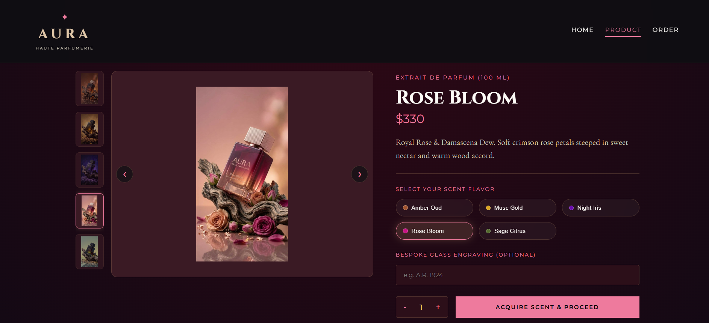
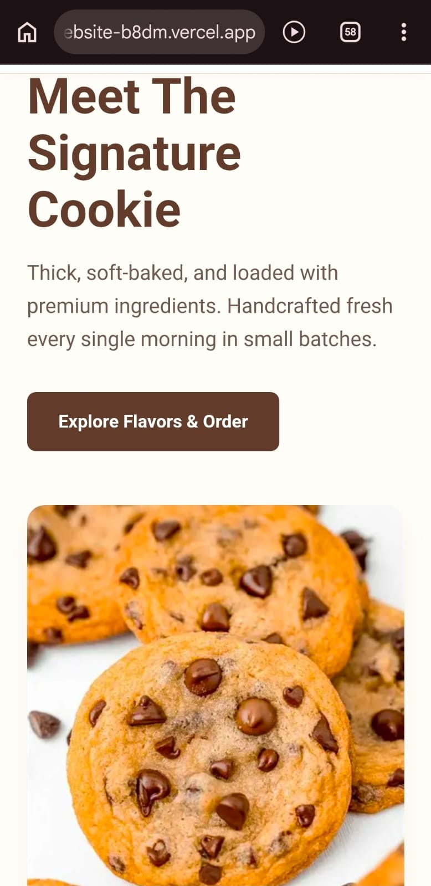

<div align="center">

# Rida Hassan

### BSCS Student · Web Developer · Qarshi University, Lahore

An animated, scroll-driven portfolio built with plain HTML, CSS and JavaScript.

[Perfume Website](https://perfume-website-theta-sooty.vercel.app/) · [Cookies Website](https://cookies-website-b8dm.vercel.app/) · [GitHub](https://github.com/RidaaHassan)

</div>

---

## About

I am a BSCS 5th semester student at Qarshi University, Lahore. I enjoy building clean, responsive websites and solving problems with code. This portfolio presents my projects, education, skills and certifications, and I am open to tech roles and collaboration.

## Preview

| Desktop project | Mobile project |
| :---: | :---: |
|  |  |
| **Perfume website** | **Cookies website** |

## Highlights

- **3D scroll story:** a laptop and a phone fly in, zoom to full screen and show my live projects as you scroll
- **Dark and light themes:** one click to switch, and your choice is remembered
- **Playful details:** custom heart cursor, sparkle trail, tilting cards and animated skill meters
- **Working contact form:** messages arrive directly in my inbox
- **Responsive and accessible:** works on phones and desktops, supports keyboard focus and reduced motion

## Projects

| Project | Description |
| --- | --- |
| **Retire Smart** | Pension tracking and disbursement app with a simple, intuitive UI |
| **Attendance Management System** | Web and desktop app to log, maintain and analyze attendance |
| **Secure File Transfer** | Hybrid encryption (AES-256, RSA-2048, SHA-256) with a Gradio web interface |
| **Perfume website** | Live on Vercel |
| **Cookies website** | Live on Vercel |

## Skills

| Area | Tools |
| --- | --- |
| Programming | C++, Java |
| Web development | HTML, CSS, JavaScript |
| Databases | SQL |
| Tools and platforms | Git, GitHub, Vercel |

## Tech used

HTML5, CSS3 and vanilla JavaScript with no frameworks or libraries. Fonts are Syne and Manrope from Google Fonts. The site is deployed on Vercel.

## Project structure

```
├── index.html               Page content
├── style.css                Layout, themes and animations
├── script.js                Scroll scenes, cursor, theme and contact form
├── perfume-desktop.webp     Desktop screenshot
├── cookies-mobile.webp      Phone screenshot (portrait)
├── cookies-landscape.webp   Phone screenshot (landscape)
└── rida.jpg                 Portrait photo (optional)
```

## Run locally

```bash
git clone https://github.com/RidaaHassan/<repository-name>.git
cd <repository-name>
```

Then open `index.html` in your browser.

## Contact

- **Email:** ridahassan.work@gmail.com
- **GitHub:** [RidaaHassan](https://github.com/RidaaHassan)
- **Location:** Jubilee Town, Lahore, Pakistan

---

<div align="center">

Made by Rida Hassan, 2026

</div>
